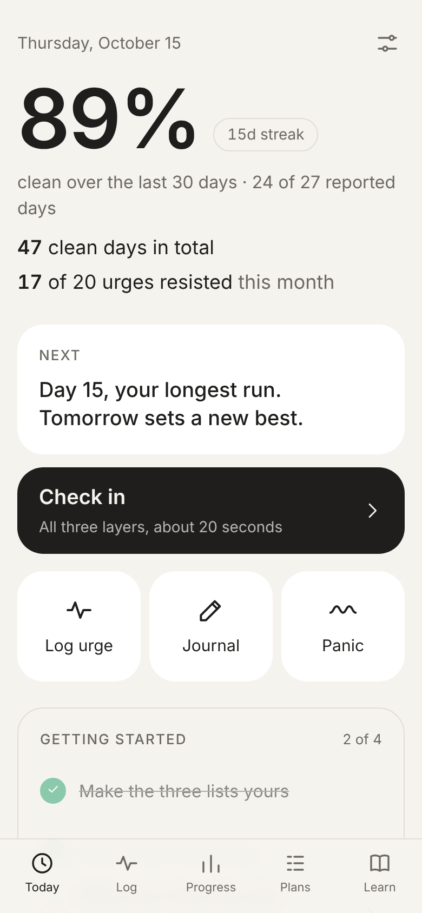
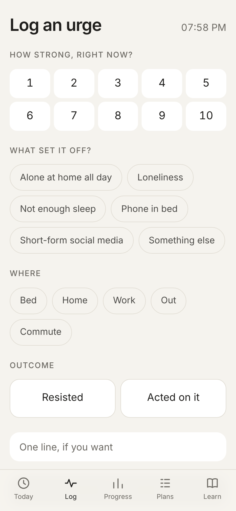
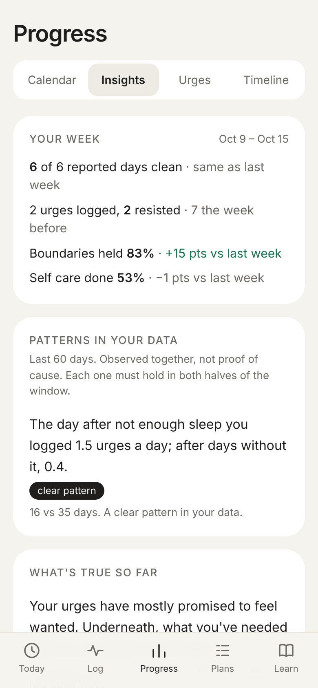

# Freelay

A free, private tracker for people quitting a habit or addiction (porn, scrolling, gaming,
gambling, alcohol, smoking, binge eating, OCD compulsions and more). It runs only on your
phone: no account, no server, no analytics, and no network requests.

### **[Open the app →](https://candanumut.github.io/Freelay/)**

Works on your phone; add it to your home screen and it works offline from then on.

<p>
  
  
  
</p>

<sub>Screenshots use the built-in made-up sample data.</sub>

## What you get

- A 20-second daily **check-in** across three layers: what you're stepping away from, what makes it harder (boundaries), and what helps (self care).
- **Log an urge** in three taps, even when you resist it, plus a full-screen **Panic** timer for riding an urge out.
- **Honest insights** from your own data, such as "on days you slept before midnight, your clean rate was higher". Patterns must pass a strict test before they are shown, and they are labelled as patterns, not causes.
- **Plans**: if-then plans for your triggers, a calm day-after plan for setbacks, and a replacement habit.
- **Learn**: 23 short lessons on urges, habits, sleep, setbacks and shame, with the research behind each one.
- Optional PIN or Face ID screen lock, light and dark themes, and JSON export/import for backups.

## Private by design

Everything you enter stays in your browser's storage (IndexedDB) on your phone. The only
network traffic is loading the app itself (and its updates) from GitHub Pages; a Content
Security Policy blocks every other request. Nothing you enter is sent anywhere, and there is
no account to create.

The flip side: **your data is lost if you clear your browser data or delete the app.**
Export a backup now and then (Settings → Data and backup).

## Install on iPhone

1. Open [the app](https://candanumut.github.io/Freelay/) in Safari, then tap **Share → Add to Home Screen**. It installs as "Freelay", with a plain icon.
2. Open it once while online. After that it works in airplane mode.

## Limits on iOS

- **The PIN and Face ID only hide the screen; nothing is encrypted.** Face ID uses WebAuthn with no server to check the signature. It hasn't been tested on a real iPhone yet.
- **Hiding the app-switcher snapshot is best effort.** The screen is covered as soon as the page is hidden, but iOS gives no guarantee for web apps.
- **Export regularly.** Home-screen apps are exempt from Safari's 7-day storage cap, and the app requests persistent storage. Still, deleting the app deletes its data. Today shows a reminder when you haven't exported in 21 days.
- **There are no push notifications,** because they're unreliable in iOS PWAs. The check-in card on Today is the daily prompt.

## How it works

[docs/how-it-works.md](docs/how-it-works.md) covers each screen, how insights were tuned with
a simulator of synthetic users, and the honesty rules in the code (for example, the clean rate
ignores unreported days and always shows how many days were reported). The simulation results
are in [docs/simulation-findings.md](docs/simulation-findings.md) and
[docs/simulation-report.md](docs/simulation-report.md).

Freelay is a self-tracking tool, not treatment, and it makes no medical claims. If you are
struggling, please reach out to a doctor, a counsellor or a local support service.

## Run it yourself

```sh
npm install
npm run dev        # http://localhost:5173
npm test           # unit tests, including a printed report on the 60-day sample data
npm run build      # production build + service worker
npm run preview    # serve the build (the service worker works here, not in dev)
npm run sim        # rerun the simulation and rewrite the report
```

To see the app with history: **Settings → Data and backup → Load sample data**.

Every push to `main` deploys to GitHub Pages (`.github/workflows/deploy.yml`: install, test,
build, publish `dist/`). One-time setup: **Settings → Pages → Build and deployment → Source: GitHub Actions**.

## License

No license has been chosen yet, so for now the code is all rights reserved.
